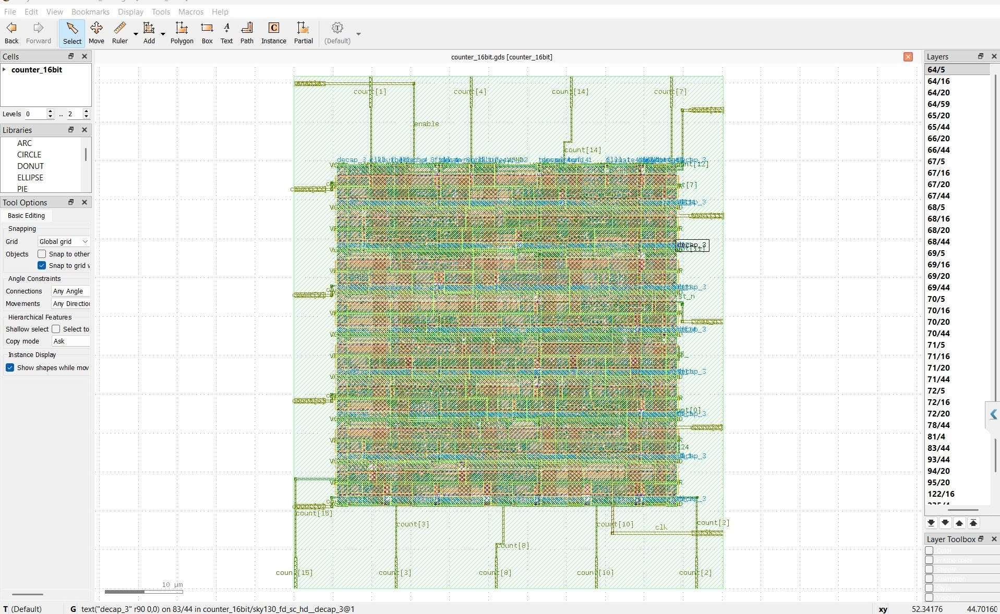
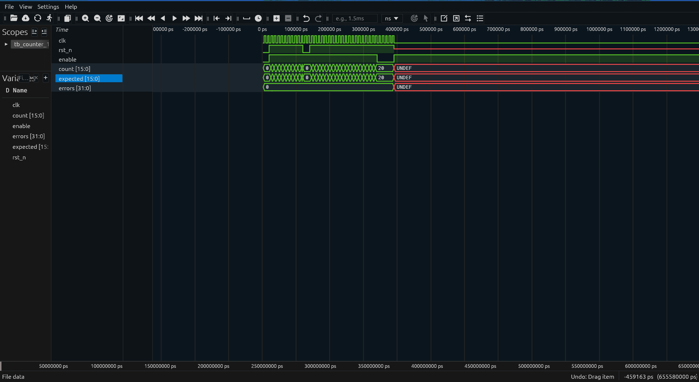
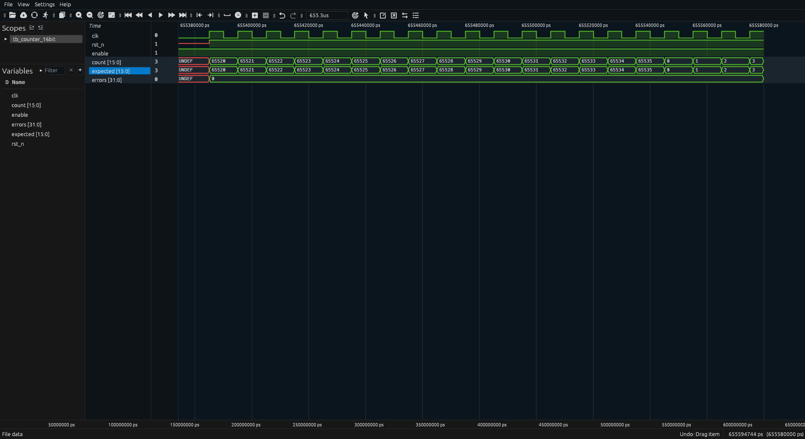

# 16-bit Synchronous Counter: RTL to GDSII on SKY130

A 16-bit up-counter taken through a complete open-source digital IC flow:
Verilog RTL, self-checking simulation, logic synthesis, place and route,
and DRC/LVS sign-off with OpenLane on the SkyWater SKY130 PDK.

Course project for *Digital IC Design* (Thiết kế vi mạch điện tử),
University of Science, VNU-HCM, 2026.



## Design

| Port     | Dir | Width | Description                              |
|----------|-----|-------|------------------------------------------|
| `clk`    | in  | 1     | Clock, rising edge                       |
| `rst_n`  | in  | 1     | Asynchronous reset, active low           |
| `enable` | in  | 1     | Count when 1, hold value when 0          |
| `count`  | out | 16    | Current count, wraps `0xFFFF -> 0x0000`  |

Source: [`src/counter_16bit.v`](src/counter_16bit.v)

## Verification

[`tb/tb_counter_16bit.v`](tb/tb_counter_16bit.v) is self-checking: a reference
model computes the expected value every cycle and a checker compares it with
`count` on the falling edge. It prints `RESULT: PASS` or the number of errors.

| Test | What it checks                                  |
|------|-------------------------------------------------|
| 1    | Counts up from 0 to 10 after reset release      |
| 2    | Asynchronous reset held for 2 clock cycles      |
| 3    | `enable = 0` holds the value for 5 cycles       |
| 4    | Overflow `0xFFFF -> 0x0000`                     |

**Tests 1–3: count up, asynchronous reset, enable hold.** `count` reaches
10, drops to 0 as soon as `rst_n` goes low, counts again to 20, then holds
20 while `enable = 0`. `count` matches the reference `expected` throughout
and `errors` stays 0. The signals turn `UNDEF` after ~390 ns only because
the testbench pauses waveform dumping (`$dumpoff`) during the long count.



**Test 4: overflow.** Dumping resumes at 0xFFF0 (65520): `count` runs up
to 65535, wraps to 0 and keeps counting, still equal to `expected`, with
`errors = 0`. The `UNDEF` at the left edge is the end of the paused dump.



Run with Icarus Verilog:

```bash
iverilog -o sim_counter src/counter_16bit.v tb/tb_counter_16bit.v
vvp sim_counter
gtkwave counter_16bit.vcd
```

## Physical implementation (OpenLane)

Configuration: [`config.json`](config.json): `sky130A`,
`sky130_fd_sc_hd`, `CLOCK_PERIOD = 10 ns`, `FP_CORE_UTIL = 40 %`.
The flow runs synthesis (Yosys), floorplan, placement, clock tree synthesis,
routing (OpenROAD), then DRC (Magic) and LVS (Netgen).

## Results

| Metric                                   | Value                         |
|------------------------------------------|-------------------------------|
| Cells after synthesis (Yosys)            | 53 (16 `dfrtp_2` flip-flops + 37 logic cells) |
| Cell area after synthesis                | 778.25 µm²                    |
| Core area                                | 1901.82 µm²                   |
| Physical cells after P&R                 | 262 (incl. fill, tap, decap)  |
| Magic DRC violations                     | 0                             |
| LVS                                      | Clean (97 nets matched)       |
| Antenna violations                       | 0                             |
| Critical path                            | 1.21 ns (at 10 ns clock constraint) |
| Sign-off setup slack, worst of all corners | +5.58 ns (met, 10 ns clock) |
| Sign-off hold slack, worst of all corners  | +0.13 ns (met)              |
| Power, typical corner                    | ≈ 0.30 mW (default switching activity) |

Sign-off STA uses OpenROAD/OpenSTA on the extracted parasitics, across
fastest/typical/slowest process corners and min/nom/max RC extraction.
The worst setup path starts at the `enable` input (2 ns default input delay).

Synthesis cell breakdown: `dfrtp_2` ×16, `xor2_2` ×7, `and4_2` ×6,
`nor2_2` ×6, `and3_2` ×5, `and2_2` ×4, `o21ba_2` ×4, `a21oi_2` ×2,
`a31o_2` ×1, `and2b_2` ×1, `buf_1` ×1.

## Authors

- Hồ Anh Tuấn
- Đào Trần Hoàng Quân
